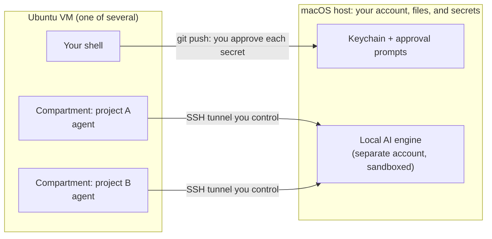

# bulkhead

bulkhead is how I run AI coding agents, such as Claude Code and pi, so
that one that's out of control can do only limited damage. It's a set
of setup scripts and small wrappers for a macOS host running Ubuntu
Linux virtual machines (VMs).

An agent that can read files, run commands, and browse the web is
useful, but it can also be wrong, be steered by a prompt injection in
something it read, or run code it shouldn't. Run it in your own
account, and it has your credentials, your files, and the ability to
push to your repositories. I want agents to stay useful (reading the
web, editing code, running commands, and proposing changes for me to
review) while limiting what one can do when it goes wrong.

It's built for my own machines (a Mac with UTM, and Ubuntu guests),
but the scripts are meant to be reusable, and I've documented the
design in case it's a useful starting point for others.

## The approach: two layers

### Layer 1: the host and its VMs

- **AI harnesses run only inside VMs.** The VMs hold your project
  checkouts, but no passwords, private keys, or long-lived tokens.
  Their outbound traffic is limited to a few ports (nftables).
- **The Mac holds every secret,** in Keychain, and releases one only
  when you click "Authorize" on a prompt that says which secret and
  why. Your own shell in a VM can get a secret this way (e.g., for `git
  push`); an agent's request is refused, since it has no session
  handle. See
  [architecture.md](architecture.md).
- **The local inference engine runs on the Mac,** for its GPU and
  unified memory, severely restricted: under its own unprivileged
  account, which can't read your home directory, in a macOS sandbox,
  listening only on the Mac's own loopback. A VM reaches it only
  through an SSH tunnel you open (`infer-access.sh`); in "secure" mode,
  only your secure VM can, and switching modes wipes the engine's
  state. It keeps prompts and replies only in memory (zero data
  retention). See [local-ai-plan.md](local-ai-plan.md).

### Layer 2: compartments within each VM

Each project in a VM (`~/projects/NAME` or `~/sensitive/NAME`) is a
*compartment*, so an agent that's out of control in one can't read,
change, or reach what belongs to another, or to the VM itself. You
start an agent with `compart`, e.g., `compart claude` or `compart pi`,
and run code an agent wrote with `compart sh` (e.g., `compart sh make
test`). Each launch nests these:

1. **`anon-access`** strips your credentials and session handles from
   the environment.
2. **pasta** gives the compartment its own network namespace: its own
   loopback, and none of the VM's ports unless you list them.
3. **bubblewrap** gives it its own view of the filesystem, built from
   what the harness's sandbox profile grants and nothing else; its own
   copies of the harness's state, `/tmp`, `/dev`, and `/run`; and its
   own kernel keyring.
4. **nono** sandboxes the agent: file rules (Land&#108;ock), a filtering
   proxy that allows only listed sites and, per site, only listed HTTP
   methods (GET and HEAD to the whole web, except under `~/sensitive`,
   where only a short allowlist applies), "phantom" credentials so the
   agent never sees your real Claude login, and Unix socket mediation.

Each compartment's state, policy, and logs live in its *dossier*,
outside the workspace, where no agent can reach. The agent can read
files you give it (`inbox/`) and leave files for you (`outbox/`, which
it can write but not read back). `compart` also watches for risky
changes to the workspace's git settings (e.g., a planted filter that
would run a program the next time *you* run git there), and asks you
to approve them. See [compartments.md](compartments.md).

## Threat model

The adversary I plan for is **an AI agent that's out of control in one
compartment**: mistaken, manipulated by what it read, or hostile, and
running arbitrary code as my (unprivileged) VM user.

### Goals

Such an agent mustn't be able to:

- Get my credentials, or use them without my approval (e.g., push to
  GitHub, or reach Heroku).
- Read or change my files outside its own workspace, or reach
  anything on the Mac but the local engine (and that only once I've
  opened its tunnel).
- Read, change, or reach another compartment: its files, state,
  sockets, processes, or terminals, or leave something there for
  another agent to find.
- Reach the VM's own services (e.g., Docker, the session bus, or my
  SSH and GPG agents), or run code outside its sandbox.
- Reach sites, or use HTTP methods, that the network policy doesn't
  allow.
- Change its own policy, approvals, or logs.

Making it hard for two compartments to *collude* is a secondary goal:
covert channels can't be closed entirely, but they shouldn't be easy.

### Non-goals

These are out of scope, or accepted risks:

- **Kernel or hypervisor exploits.** Everything in a VM shares one
  kernel; an exploit there breaks out of every compartment. The VM is
  the next boundary, and the secure VM is for work that needs a
  stronger one.
- **Root inside a VM,** or a compromised Mac.
- **Sending data out over allowed traffic.** Outside `~/sensitive`,
  an agent can GET any URL, so it could put data in one. That's a
  deliberate trade for usefulness; put sensitive work under
  `~/sensitive`. Agents using a remote model also send their context
  to that model's provider.
- **Code you run yourself, outside a compartment,** from an agent's
  workspace (e.g., a `Makefile` it wrote). Use `compart sh`, or review
  it first. The git check is the exception: it covers what git would
  run without your spelling it out.
- **Damage within its own workspace.** An agent can wreck its own
  project; commit often (an undo is proposed).
- **Side channels** (e.g., timing), and denial of service (e.g., using
  up the VM's memory or disk).
- **Flaws in the tools themselves** (nono, bubblewrap, pasta, the
  harnesses), beyond testing that they do what we rely on.

## Status

I use this myself, and it's in active development. It's tested
(`./ci.sh`, plus hand-run tests in a VM that sweep a compartment for
anything it shares), but it hasn't had an independent security review.
It supports only a macOS host with Ubuntu guests under UTM today; most
of the design isn't tied to those.

## Learn more

- [INSTALL.md](INSTALL.md): how to set up the Mac and its VMs.
- [FILES.md](FILES.md): what each file in this repository does.
- [architecture.md](architecture.md): the host, VMs, and secrets
  server, and why.
- [compartments.md](compartments.md): compartments, dossiers, and how
  they're built and tested.
- [local-ai-plan.md](local-ai-plan.md): the local inference engine's
  design and history.
- [agent-network-plan.md](agent-network-plan.md): the agents' network
  policy.
- [git-check-rationale.md](git-check-rationale.md): which git setting
  changes need your approval, and why.
